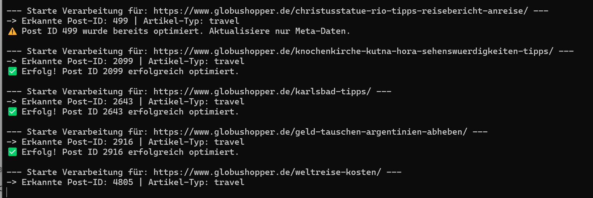

# Automatisierte GEO-Inhaltsoptimierung für Legacy-Websites

In diesem Projekt wurde eine modulare Automatisierungs-Pipeline in Python entwickelt, um einen seit Jahren inaktiven Reiseblog ([globushopper.de](http://globushopper.de/)) datenbasiert zu analysieren und grundlegend zu modernisieren. Das System schlägt die Brücke zwischen klassischem CMS-Inhalt und den Anforderungen moderner KI-Suchmaschinen (wie Perplexity, ChatGPT Search und Google AI Overviews).

Von der automatisierten Extraktion unterperformender URLs über die KI-gestützte Inhaltsanreicherung (inklusive strukturierter Daten, Tabellen und FAQs) bis hin zur fehlerfreien, vollautomatischen Rückspielung via WordPress REST API arbeitet die Pipeline komplett autonom. Besonderes Augenmerk wurde dabei auf defensive Programmierung gelegt: Durch integrierte Schutzmechanismen gegen blockierende Inhaltsverzeichnisse (TOCs), fehlerhafte Gutenberg-Editor-Blöcke, doppelte Injektionen sowie API-Rate-Limits läuft das System absolut stabil im Hintergrund.

## 1. Projektprofil

**Projektart:** Automatisierungsskript & Content-Pipeline

**Tech-Stack**: Python (pandas, requests, BeautifulSoup), OpenAI API (gpt-4o), WordPress REST API

**Ziel**: Ein Python-basiertes Automatisierungstool, das einen inaktiven Reiseblog ([globushopper.de](http://globushopper.de/)) datenbasiert analysiert und für moderne KI-Suchmaschinen aufbereitet.

## 2. Ausgangslage & Motivation

Ein älterer Blog verzeichnete zwar über einen längeren Zeitraum konstante Impressionen, lief aber bei den Klicks (CTR) mangels Struktur und moderner SEO-/GEO-Signale hinterher. Die manuelle Überarbeitung von fast 90 Artikeln kam zeitlich nicht infrage. Ziel war daher eine schlanke, modulare Automatisierungslösung, die den Prozess von der Datenanalyse bis zum CMS-Update komplett autonom steuert.

## 3. Architektur & Funktionsweise (Modularer Aufbau)

Das Projekt ist in drei logische Module unterteilt, die über einen zentralen Batch-Runner gesteuert werden:

### A) GSC-Analyzer (gsc_audit.py):

- Extrahiert Leistungsdaten aus der Google Search Console via API.
- Filtert automatisiert nach Artikeln mit hohem Potenzial (hohe Impressionen, niedrige Klickrate) und speichert diese als verarbeitbare Arbeitsliste (gsc_quick_wins.csv).

### B) GEO-Transformer (geo_transformer.py):

- Scrapt den Live-Inhalt des jeweiligen Artikels per BeautifulSoup.
- Unterscheidet dynamisch nach Artikel-Typ (z. B. *Travel* vs. *Groundhopping*) und steuert das LLM über kontextspezifische Prompts an.
- Generiert strukturierte Daten wie Executive Summaries, Quick Facts, Insider-Tipps, strukturierte Tabellen und valides JSON-LD [Schema.org](http://schema.org/) Markup (FAQPage).

### C) WordPress-Publisher & Batch-Runner (batch_geo_optimizer.py):

- Ermittelt Post-IDs dynamisch über die WordPress REST API anhand des Slugs.
- Führt einen integrierten State-Check durch (Vermeidung von Duplikaten durch Prüfung auf Marker-Phrasen).
- Injiziert die Inhalte sauber formatiert in den Gutenberg-Editor und aktualisiert SEO-Meta-Daten.

## 4. Technische Hürden & pragmatische Lösungen

Bei der Umsetzung mussten einige typische Fallstricke im Zusammenspiel von LLMs, Web-Scraping und CMS-Schnittstellen gelöst werden:

- **TOC-Kollisionen verhindern**: Damit LLM-generierte Infoboxen nicht die bestehenden Inhaltsverzeichnisse (Table of Contents) des Blogs sprengen, wurde im System-Prompt explizit festgelegt, dass statt echter HTML-Überschriften (<h3>, <h4>) ausnahmsweise stark hervorgehobener Text (<strong>) verwendet wird.
- **Gutenberg-Stabilität**: Rohes HTML im WordPress-Editor kann schnell zu fehlerhaften Blöcken führen. Die generierten Elemente werden daher strikt in isolierte HTML-Container (<!-- wp:html -->) gekapselt und per CSS (.globus-table) einheitlich gestylt.
- **Idempotenz / Duplikat-Schutz**: Um das Skript mehrfach sicher ausführen zu können, prüft ein Marker-Check (📊 Fakten & Übersicht), ob ein Artikel bereits optimiert wurde. Bereits bearbeitete Posts werden übersprungen; lediglich Meta-Daten werden bei Bedarf aktualisiert.
- **Fehlertoleranz & API-Schutz**: Abfangroutinen für leere LLM-Antworten (NoneType-Handling) sowie eingebaute Zeitverzögerungen (time.sleep()) verhindern Server-Überlastungen und Rate-Limits bei Massenläufen.

## 5. Key Insights & Learnings

- **Struktur schlägt reines Keyword-Stuffing:** Für moderne, KI-gestützte Suchmaschinen (GEO) ist es essenziell, Informationen maschinenlesbar aufzubereiten. Klare FAQ-Schemata, kompakte Quick-Facts und übersichtliche Tabellen werden von LLMs deutlich besser priorisiert als klassische, verschwurbelte SEO-Einleitungen.
- **Defensive Programmierung ist bei CMS-APIs essenziell:** Automatisierungen, die direkt in Live-Systeme schreiben, benötigen zwingend harte Schutzmechanismen (wie Idempotenz-Prüfungen durch Marker-Phrasen). Ohne einen solchen Schutz führt ein erneuter Skript-Durchlauf unweigerlich zu unkontrollierten Duplikaten und Datenmüll.
- **Saubere Kapselung schützt das Frontend:** Die direkte Arbeit mit REST-APIs und Headless- oder Block-Editoren (wie WordPress Gutenberg) erfordert striktes HTML-Sanitizing. Das Verpacken von injizierten Inhalten in native HTML-Blöcke verhindert effektiv, dass der Editor beim nächsten manuellen Aufruf den Dienst verweigert ("Block enthält ungültigen Inhalt").
- **API-Resilienz und Raten-Begrenzung**: Externe Schnittstellen (OpenAI, CMS-Backends) reagieren empfindlich auf ungezügelte Massenanfragen. Das Einbauen von Fehlerabfängen (z. B. für leere LLM-Payloads) und absichtlichen Pausen (time.sleep) verwandelt ein fehleranfälliges Skript in einen robusten, unbeaufsichtigt laufenden Hintergrund-Worker.