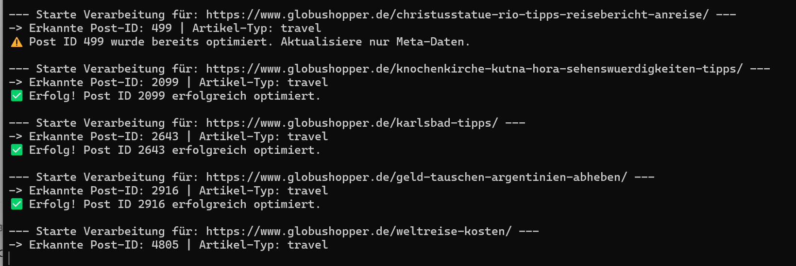

# 🌍 Automatisierte GEO-Inhaltsoptimierung für Legacy-Websites

> Eine modulare Python-Automatisierungs-Pipeline zur datenbasierten Modernisierung von Legacy-Inhalten für moderne KI-Suchmaschinen (Generative Engine Optimization).

---

## 💡 Hinweis zur Entwicklung (AI-Driven Architecture & Development)
*Transparenz-Hinweis:* Dieses Projekt wurde von mir als Solution Architect und Product Owner konzipiert und umgesetzt, wobei ich **Modern AI-Coding-Tools als High-Performance-Entwicklungspartner** genutzt habe. Mein Fokus lag dabei voll und ganz auf Systemarchitektur, Datenfluss, API-Schnittstellen (GSC & WordPress), Sicherheits- und Fallback-Mechanismen sowie dem komplexen Prompt-Engineering. Das Projekt demonstriert mustergültig, wie man als moderner Builder und Architekt KI-Kollaboration einsetzt, um hochfunktionale, fehlerresistente Automatisierungs-Pipelines in Rekordzeit auf Enterprise-Niveau zu realisieren.

---

## 🚀 Executive Summary

* **Herausforderung:** Ein älterer Blog verzeichnete über einen längeren Zeitraum konstante Impressionen, lief aber bei den Klicks (CTR) mangels Struktur und moderner SEO-/GEO-Signale hinterher. Die manuelle Überarbeitung von fast 90 Artikeln kam zeitlich nicht infrage.
* **Lösung:** Entwicklung einer schlanken, modularen Automatisierungslösung, die den Prozess von der Datenanalyse (Google Search Console) bis zum CMS-Update über die WordPress REST API komplett autonom steuert.
* **Kern-Ergebnis:** Vollautomatisierte Anreicherung unterperformender URLs mit strukturierten Daten, Tabellen und FAQs, abgesichert durch defensive Programmierlogik (Duplikat-Schutz, TOC-Kollisionsschutz und Raten-Begrenzung).

---

## 🛠️ Tech Stack & Infrastructure Setup

### Key Technologies

* **Data Engineering & Automation:** Python (`pandas`, `requests`, `BeautifulSoup`), Google Search Console API
* **Artificial Intelligence:** OpenAI API (`gpt-4o` mit strukturiertem JSON-Output und Anti-Halluzinations-Prompting)
* **CMS & Content Integration:** WordPress REST API (Gutenberg-HTML-Block-Injektion, Yoast SEO Meta-Optimierung)
* **Datenschutz & Security:** Sichere OAuth2-Authentifizierung per Google Service Account (`client_secret.json`) sowie Credentials-Handling über lokale Umgebungsvariablen.

### Warum diese Architektur für Content-Automation entscheidend ist

1. **Schnittstellen-Resilienz & Blockade-Schutz:** Der Einsatz realistischer Browser-User-Agents verhindert Firewall- und Cloudflare-Sperren beim automatisierten Scraping.
2. **Defensive CMS-Injektion:** Rohes HTML wird strikt in isolierte WordPress-Gutenberg-Blöcke (`<!-- wp:html -->`) gekapselt, um Editor-Fehler oder beschädigte Inhaltsverzeichnisse (TOCs) zu verhindern.
3. **Idempotenz & Duplikat-Schutz:** Ein integrierter Marker-Prüfschritt (`📊 Fakten & Übersicht`) stellt sicher, dass bereits optimierte Artikel bei mehrfachen Skript-Durchläufen nicht doppelt befüllt werden.

---

## ⚡ Logic & Architecture Overview

Das Projekt ist in eigenständige Module unterteilt, die flexibel oder über den Batch-Runner gesteuert werden:

1. **GSC-Analyzer (`gsc_audit.py`):** Extrahiert Leistungsdaten aus der Google Search Console via API und filtert vollautomatisch nach Quick-Win-Potenzialen (hohe Impressionen, niedrige CTR, Position $\le 20$).
2. **GEO-Transformer (`geo_transformer.py`):** Scrapt Live-Inhalte per BeautifulSoup, unterscheidet dynamisch nach Artikel-Typ (z. B. Travel vs. Groundhopping) und generiert über LLMs strukturierte FAQs, Infoboxen und Tabellen.
3. **WordPress-Publisher & Batch-Runner (`batch_geo_optimizer.py` / `run_geo_optimizer.py`):** Ermittelt Post-IDs dynamisch über den URL-Slug, steuert den Duplikat-Check und injiziert das fertige Pro-GEO-Paket in das Live-System.

---

## 🔍 Implementation Details

### A. Datengestützte Potenzialanalyse (`gsc_audit.py`)
* Anbindung der Google Search Console API via OAuth2-Service-Account.
* Automatisierte Filterung und Export der Top-Optimierungskandidaten als `gsc_quick_wins.csv`.

### B. LLM-gestützte Inhaltsanreicherung (`geo_transformer.py`)
* Kontexterkennung und strikter Anti-Halluzinations-Schutz (Nutzung ausschließlich realer Fakten aus dem extrahierten Artikeltext).
* Generierung von Yoast-kompatiblen Meta-Daten, Quick-Facts-Boxen und validem JSON-LD Schema.org Markup (`FAQPage`).

### C. Autonomer WordPress-Publishing-Workflow
* Dynamische Post-ID-Auflösung über die WP REST API (`/wp/v2/posts?slug=...`).
* Saubere Formatierung von responsiven HTML-Tabellen mit individuellem Corporate-Design-Anstrich und automatisierter Fallback-Logik bei leeren LLM-Antworten.

---

## 🖼️ Script Execution & Audit Overview



---

## 🎯 Key Learnings & Strategic Takeaways

1. **Struktur schlägt Keyword-Stuffing:** Für moderne, KI-gestützte Suchmaschinen (GEO) ist es essenziell, Informationen maschinenlesbar aufzubereiten (FAQ-Schemata, kompakte Tabellen).
2. **Defensive Programmierung bei CMS-APIs:** Automatisierungen, die direkt in Live-Systeme schreiben, benötigen zwingend harte Schutzmechanismen (Marker-Prüfungen), um unkontrollierte Datenmüll-Injektionen zu verhindern.
3. **Effiziente KI-Nutzung als Builder:** Komplexe technische Workflows lassen sich durch zielgerichtetes Prompt-Engineering, saubere Architekturvorgaben und logische Kontrollstrukturen erfolgreich realisieren.

---

## 📂 Repository-Structure

```text
├── Scripts/
│   ├── batch_geo_optimizer.py   # Zentraler Batch-Runner & Orchestrator
│   ├── geo_transformer.py       # LLM-Content-Generierungs-Modul
│   ├── gsc_audit.py             # Google Search Console Extraktions-Modul
│   ├── run_geo_optimizer.py     # Einzel-Testlauf & Steuerungs-Skript
│   └── wp_publisher.py          # Modul für manuelle/zielgerichtete Updates
├── Docs/
│   └── gsc_quick_wins.csv       # Potenzial-Analyse & Ziel-URL-Liste
├── Pictures/
│   └── script-execution-log.png # Terminal Log & Ausführungs-Asset
└── README.md                    # Projektdokumentation

(Hinweis: Der Google Service Account (client_secret.json) sowie persönliche API-Zugangsdaten verbleiben aus Sicherheits- und Datenschutzgründen in der lokalen Umgebung und sind über .gitignore vom Public Upload ausgeschlossen).
